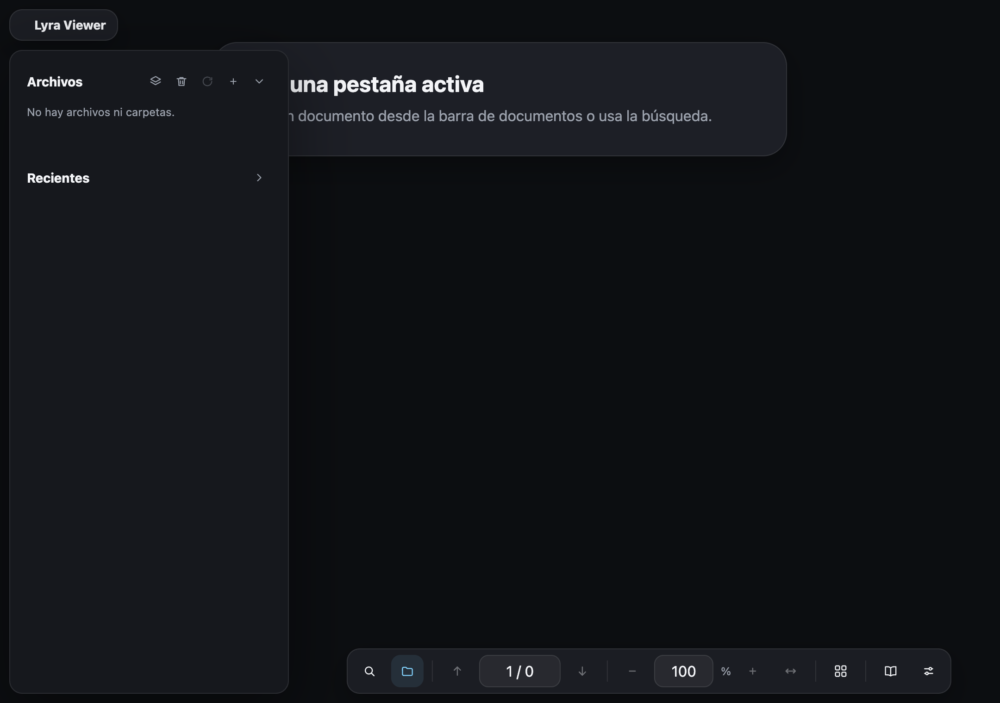

# Lyra Viewer



Lector de documentos de escritorio ligero y privado, construido con **Svelte 5**,
**Tauri 2**, **Rust**, **SQLite** y **pdf.js**. Lyra organiza documentos locales
sin subirlos a un servicio externo y mantiene la biblioteca, las preferencias y
la posición de lectura en el equipo del usuario.

> Proyecto en desarrollo. La interfaz y el modelo de documentos siguen
> evolucionando; consulta [TECH_DEBT.md](TECH_DEBT.md) para conocer el trabajo
> pendiente.

## Funcionalidades

- Biblioteca persistente de documentos, carpetas, categorías y papelera en SQLite.
- Visor con páginas, miniaturas, índice, búsqueda, marcadores y comentarios.
- Soporte para documentos PDF y módulos preparados para Markdown, Typst y EPUB.
- Pestañas con estados `active`, `idle` y `hibernated` para controlar el coste de
  documentos abiertos.
- Restauración de página, zoom, vista y otras preferencias por documento.
- Carpetas sincronizadas con escaneo inicial, seguimiento de cambios y pausa o
  reanudación manual.
- Detección de movimientos externos mediante identidad de archivo
  (`device_id` + `inode`) para evitar duplicados al mover documentos.
- Organización por categorías, documentos recientes y posiciones persistentes.
- Eliminación opcional del contenido desde Lyra conservando el archivo original
  según la acción elegida.
- Interfaz adaptable con modo oscuro, barra de título integrada en macOS y
  controles de lectura configurables.

## Arquitectura

```text
Svelte 5 + TypeScript
        │
        │ comandos y eventos IPC
        ▼
Tauri 2 + Rust
        │
        ├── Biblioteca y sincronización de carpetas
        ├── Watcher de cambios del sistema de archivos
        ├── Protocolo local para documentos
        └── SQLite + migraciones
```

- `src/`: interfaz, stores reactivos, componentes y visor.
- `src-tauri/src/`: comandos Rust, sincronización, watcher, base de datos y
  protocolo de documentos.
- `src-tauri/migrations/`: evolución versionada del esquema SQLite.
- `src-tauri/capabilities/`: permisos y capacidades de Tauri.
- `tests/` y `e2e/`: pruebas del shell y flujos de extremo a extremo.

## Arquitectura relevante

- `src/lib/stores/viewer.svelte.ts` contiene el estado y las operaciones propias
  del visor, sin importar el estado de pestañas.
- `src/lib/stores/viewerCommands.svelte.ts` contiene `requestScrollToPage`, el
  único puente entre el visor y las pestañas. Esta separación evita un ciclo de
  imports entre ambos stores.
- Las páginas cargadas, visibles y en renderizado se identifican con claves
  `docId:page`. Así, la misma página de dos documentos no colisiona y sus
  entradas se limpian al cerrar o hibernar la pestaña.

## Requisitos

- Node.js ≥ 20
- npm
- Rust 1.99.0 (fijado en `rust-toolchain.toml`; requisito mínimo del crate: 1.90)
- Dependencias de Tauri según SO: https://tauri.app/start/prerequisites/

La ventana usa `titleBarStyle: "Overlay"` para conservar la barra de título
integrada en macOS. La compilación de Tauri se verifica en CI en Ubuntu, macOS
y Windows; en Windows/Linux Tauri aplica el comportamiento nativo compatible y
la interfaz no depende de los controles de tráfico de macOS.

## Desarrollo

```bash
npm install
npm run tauri:dev
```

Para desarrollar solo el frontend:

```bash
npm run dev
```

`npm run dev` sirve la interfaz web para trabajar en componentes. Algunas
funciones dependen de la API IPC de Tauri y solo están disponibles al ejecutar
la aplicación de escritorio con `npm run tauri:dev`.

## Comandos principales

| Comando | Descripción |
| --- | --- |
| `npm run tauri:dev` | Ejecuta la aplicación de escritorio en desarrollo |
| `npm run dev` | Ejecuta solo el frontend con Vite |
| `npm run tauri:build` | Compila la aplicación y sus instaladores |
| `npm run check` | Ejecuta `svelte-check` |
| `npm run typecheck` | Comprueba los tipos TypeScript |
| `npm test` | Ejecuta las pruebas unitarias del frontend |
| `npm run test:e2e` | Ejecuta las pruebas E2E con Playwright |
| `npm run validate` | Ejecuta tipos, chequeos, lint, tests y build |
| `cargo test --manifest-path src-tauri/Cargo.toml --lib` | Ejecuta las pruebas Rust |

Para una compilación nativa completa:

```bash
npm run tauri:build
```

Los artefactos generados aparecen bajo `src-tauri/target/` y no forman parte
del repositorio. Si se elimina esa carpeta, Cargo y Tauri la regeneran en la
siguiente compilación.

## Build

```bash
npm run tauri:build
```

## Validación

```bash
npm run check
npm run build
cargo check --manifest-path src-tauri/Cargo.toml
```

La suite de tests (`npm test`) y el lint (`npm run lint`) se ejecutan también en
CI (`.github/workflows/ci.yml`).

Para ejecutar la validación completa del frontend en local:

```bash
npm run validate
```

Este comando ejecuta TypeScript, `svelte-check`, ESLint, Vitest y el build de
producción. Las validaciones nativas equivalentes son:

```bash
cargo fmt --check --manifest-path src-tauri/Cargo.toml
cargo clippy --manifest-path src-tauri/Cargo.toml --all-targets -- -D warnings
cargo test --manifest-path src-tauri/Cargo.toml --lib
```

La suite E2E requiere Node.js 20 o superior y un entorno con Playwright:

```bash
npm run test:e2e
```

La comprobación E2E del shell solo permite el mensaje exacto que indica que la
API IPC de Tauri no existe en el servidor web; errores de consola nuevos no se
ocultan mediante filtros genéricos.

## Documentación

- `TECH_DEBT.md`: deuda técnica conocida y trabajo pendiente.
- `docs/protocolo-capa-texto.md`: cómo medir el coste, la alineación y la
  estabilidad de la capa de texto (`TextLayer`) ya integrada en el visor.

## Licencia

Copyright © 2026 David Montenegro.

Este proyecto se distribuye bajo la [licencia MIT](LICENSE). La licencia permite
usar, copiar, modificar, distribuir y comercializar el software, manteniendo el
aviso de copyright y la licencia en las copias o partes sustanciales.
